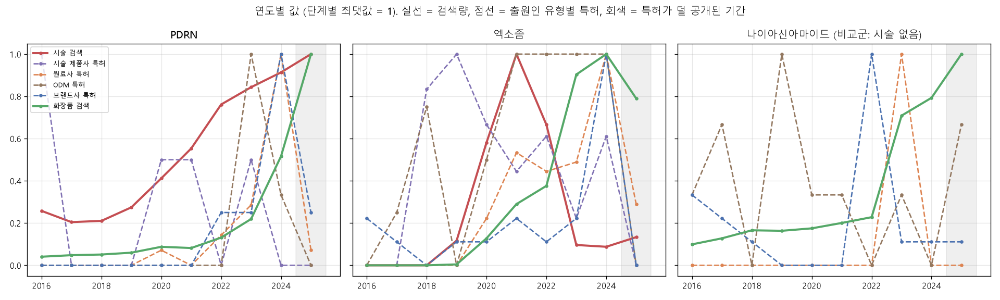
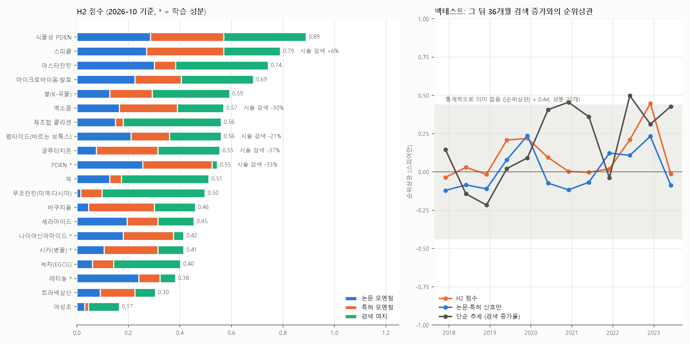
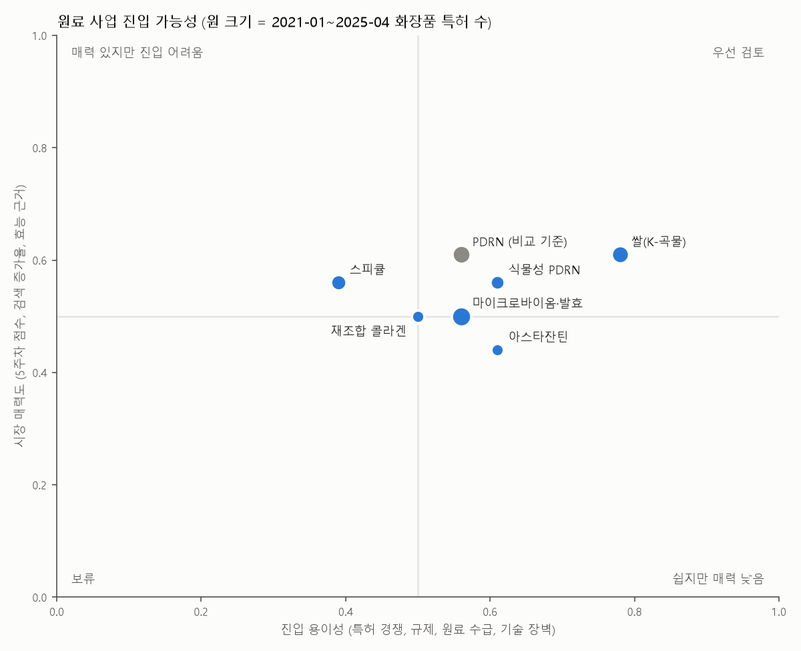
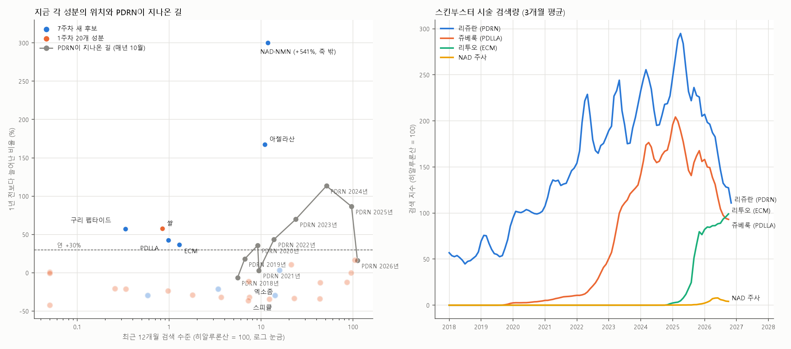
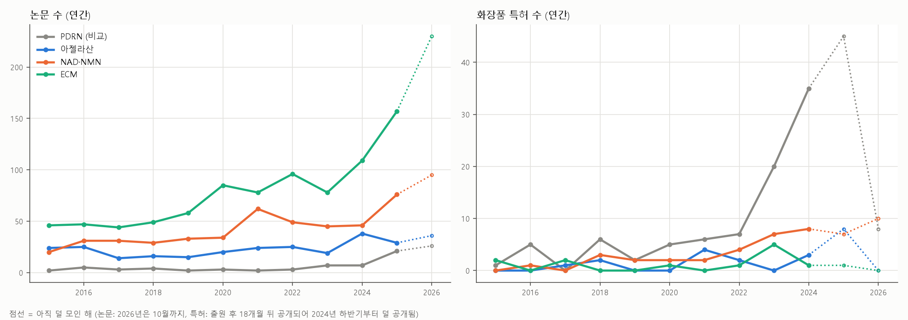

# 선행지표 기반 화장품 성분 트렌드 예측

**PDRN이 뜨기 전에 무엇이 먼저 움직였나, 그리고 다음은 무엇인가**

주혜우 · 2026년 11월 · 데이터 기준 2026년 10월

---

## 요약

화장품 원료 회사는 성분이 소비자에게 뜨기 1~2년 전에 원료를 준비해야 합니다. 이 프로젝트는 **논문·특허·검색량·피부과 시술 검색량**으로 그 시점을 미리 알 수 있는지 검증했습니다. 대상은 성분 29개이고, 2010~2026년 월별 데이터를 썼습니다.

| 질문 | 답 |
|---|---|
| 논문·특허가 소비자 관심보다 먼저 움직이나? | **성분에 따라 다릅니다.** 나이아신아마이드·레티놀은 특허가 소비자 검색보다 2~7년 먼저 올랐습니다. 반대로 PDRN은 소비자 검색이 특허보다 먼저였습니다. |
| "피부과 시술이 뜨면 원료사가 움직이고, 그다음 브랜드가 움직인다"(업계 인터뷰)는 맞나? | **앞부분은 맞습니다.** 시술 관심이 늘어난 4개 성분 모두 시술 검색이 화장품 검색보다 1~3년 먼저 올랐습니다. 다만 원료사 → 브랜드 순서는 약하게만 보였습니다. |
| 논문·특허 증가로 다음 유행 성분을 점수화할 수 있나? | **이 데이터로는 어렵습니다.** 2017~2023년 과거 시점에서 점수를 매기고 3년 뒤 결과와 맞춰 본 결과, 순위상관이 평균 0.10이었습니다. 통계적으로 의미 있는 수준(0.44)에 못 미쳤습니다. |
| PDRN 다음 후보는? | **NAD·NMN**은 논문·특허·검색·시술이 모두 오르는 유일한 성분입니다. **아젤라산**은 검색이 PDRN이 뜨기 직전과 가장 비슷하게 오르지만, 처방약 관심이 섞여 있습니다. **ECM**은 시술(리투오)과 논문이 앞서고 화장품은 아직입니다. |

**원료 사업 관점의 결론:** 성분이 뜨는 길은 두 가지입니다. 기업·연구가 주도하는 성분은 **특허**를 보고, 시술이 주도하는 성분은 **시술 검색량**을 봐야 1~3년 먼저 준비할 수 있습니다. 하나의 점수로 "다음 성분"을 고르기보다, 두 신호를 따로 보며 후보를 좁히는 방식이 현실적입니다.

---

## 1. 문제와 가설

PDRN은 2023~2025년 한국 화장품 시장에서 가장 크게 성장한 성분 중 하나입니다. 원료 회사 입장에서 중요한 질문은 "이런 성분을 **뜨기 전에** 알아볼 수 있었는가"입니다.

| 가설 | 내용 |
|---|---|
| H1 | 논문·특허가 소비자 검색보다 일정한 시차를 두고 먼저 오른다 |
| H2 | 논문·특허는 오르는데 소비자 검색은 아직 낮은 성분이 다음에 뜬다 |
| 업계 가설 | "피부과 시술이 뜨면 원료 회사가 움직이고, 브랜드가 움직인다" (로레알 인터뷰) |

## 2. 데이터

| 단계 | 출처 | 지표 | 품질 점검 |
|---|---|---|---|
| 연구 | PubMed | 월별 논문 수 (2015~) | 성분별 무작위 20편을 사람이 직접 판정해 검색식을 최대 3차까지 다듬음. 정확도 0.5 미만이던 7개 중 6개를 0.85 이상으로 개선 |
| 특허 | KIPRIS | 월별 화장품 특허 출원 수 (2010~) | 화장품 IPC(A61K 8/, A61Q) 필터를 성분별 15건 표본으로 점검. 21개 중 16개 정확도 0.8 이상 |
| 소비자 | 네이버 데이터랩 | 월별 검색 지수 (2016~) | 요청마다 기준이 달라지는 문제를 히알루론산을 공통 기준(=100)으로 넣어 보정 |
| 시술 | 네이버 데이터랩 | 시술 이름 검색 지수 (리쥬란, 쥬베룩, 리투오 등) | 같은 기준(히알루론산=100) |
| 기업 | KIPRIS 출원인 | 원료사·ODM·브랜드사·시술 제품사 분류 | 특허가 많은 상위 92개 기업을 사람이 분류 |

- **특허 공개 지연:** 특허는 출원 후 약 18개월 뒤에 공개됩니다. 그래서 최근 18개월은 덜 채워진 값으로 보고 분석에서 뺐습니다. 과거 시점을 재현할 때도 그 시점에 볼 수 있던 특허만 썼습니다.
- **성분:** 1주차에 고른 20개(학습 4: PDRN·시카·나이아신아마이드·레티놀, 후보 16), 그리고 7주차에 업계 기사로 추가한 9개입니다.

## 3. 결과 ① 논문·특허는 먼저 움직였나 (H1)

학습 성분 4개에서 본격 상승 시작점과 교차상관으로 시차를 쟀습니다.

| 성분 | 특허 → 검색 시차 (시작점 / 교차상관) | 판단 |
|---|---|---|
| 나이아신아마이드 | +84개월 / +24개월 | 특허가 앞섬 |
| 레티놀 | +41개월 / +11개월 | 특허가 앞섬 |
| PDRN | −7개월 / −5개월 | **검색이 먼저** |
| 시카 | 판단 불가 | 검색 데이터 시작(2016년) 전에 이미 유행 |

- H1은 일부만 맞습니다. 시차가 성분마다 2~7년으로 제각각이라 "N개월 뒤 뜬다"처럼 하나의 숫자로 예측하기는 어렵습니다.
- 그랜저 인과 검정은 여러 시차를 시험한 것을 보정하면 시카(특허 → 검색) 하나만 유의했습니다.

## 4. 결과 ② 시술이 먼저 뜬다 (업계 가설 검증)

PDRN에서 검색이 먼저 움직인 이유를 확인하려고 시술 검색량을 따로 모았습니다. 특허도 출원인 유형별로 나눴습니다. 시점은 모든 단계에서 같은 기준(T25: 2016년 이후 늘어난 양이 누적 25%에 도달한 달)으로 비교했습니다.

| 성분 | 시술 검색 | 화장품 검색 | 원료사 특허 | 브랜드사 특허 |
|---|---|---|---|---|
| PDRN (리쥬란) | 2022-01 | 2023-05 | 2023-08 | 2023-11 |
| 엑소좀 | 2020-12 | 2022-11 | 2021-12 | 2020-11 |
| 스피큘 (MTS) | 2018-03 | 2019-06 | 2023-07 | - |
| 글루타치온 (백옥주사) | 2017-04 | 2020-03 | - | - |

- **시술이 먼저 뜬다:** 4개 성분 모두 시술 검색이 화장품 검색보다 1~3년 먼저였습니다. 50% 도달 시점(T50)으로 바꿔도 순서는 같았습니다.
- **원료사 → 브랜드는 약함:** T50 기준 PDRN과 엑소좀 모두 원료사 특허가 브랜드사보다 몇 달 앞섰습니다. 하지만 원료사 특허는 화장품 검색과 비슷한 시기에 몰렸습니다. 원료사는 특허 없이 신원료를 내는 경우가 많아, 특허만으로는 원료사의 움직임을 다 보기 어렵습니다.
- **결론 — 성분이 뜨는 길은 두 가지:**
  - *기업·연구 주도* (나이아신아마이드, 레티놀): 특허 → (2~6년) → 소비자
  - *시술 주도* (PDRN, 엑소좀, 스피큘, 글루타치온): 시술 → (1~3년) → 화장품 소비자 → 원료사·브랜드 특허

## 5. 결과 ③ 점수로 다음 성분을 고를 수 있나 (H2)

H2를 점수로 만들었습니다: 논문 모멘텀 0.3 + 특허 모멘텀 0.3 + 검색 여지 0.4. 이 점수를 **2017년 말부터 6개월마다 그 시점 데이터만으로** 매기고, 그 뒤 3년 동안 검색이 얼마나 늘었는지와 비교했습니다(12개 시점).

| 방법 | 순위상관 평균 | 상위 5개 중 3년 뒤 검색 2배 이상 |
|---|---|---|
| H2 점수 | 0.10 | 30% |
| 논문·특허 신호만 | 0.01 | 37% |
| 단순 추세 (지금 오르는 검색이 계속 오름) | 0.19 | 42% |
| 무작위 | 0 | 26% |

- **H2 점수는 과거에 맞지 않았습니다.** 성분 20개일 때 순위상관이 0.44를 넘어야 우연이 아니라고 볼 수 있는데, 12개 시점 중 그 근처에 간 것은 1개뿐이었습니다. 논문·특허 모멘텀만 따로 보면 거의 0이었습니다.
- 3장의 결과와 같은 이유입니다. 성분마다 앞서는 신호가 다르고 시차도 제각각이라, 하나의 점수로 묶으면 신호가 섞여 사라집니다.
- **점수의 결함도 하나 발견했습니다.** 처음 점수는 "검색이 낮을수록 여지가 크다"고만 봐서, 이미 정점을 지나 **내려오는** 성분(스피큘 등)을 상위에 올렸습니다. 그래서 '유행 지남'(최근 검색이 정점의 70% 미만) 판정을 추가했습니다. 그 결과 1주차에 고른 20개 중 15개가 이미 유행이 지난 성분이었습니다.
- 그래서 점수는 "예측"이 아니라 살펴볼 후보를 좁히는 **거름망**으로만 씁니다.

## 6. 결과 ④ 원료 사업으로 들어갈 만한가

5주차 상위 성분을 **시장 매력도**(점수, 검색 증가율, 효능 근거)와 **진입 용이성**(특허 출원 기업 수·집중도·대기업 참여, 규제, 원료 수급, 기술 장벽)으로 평가했습니다. 정성 항목은 공개 기사와 업체 자료를 근거로 1~3점을 매기고, 출처를 `config/feasibility_notes.csv`에 남겼습니다.

| 성분 | 판정 | 핵심 근거 |
|---|---|---|
| 쌀 | 우선 검토 | 규제·수급·기술 부담이 낮음. 대신 진입 장벽이 낮아 차별화가 어려움 |
| 식물성 PDRN | 우선 검토 | 2021~2025년 PDRN 화장품 특허의 42%가 식물·해조류 유래. 출원 상위 기업이 기존 PDRN 원료사와 같음 → **빈 시장이 아니라 원료사들이 옮겨 가는 시장** |
| 마이크로바이옴 | 경계 | 대기업 6곳 참여 |
| 재조합 콜라겐 | 경계 | 특허의 67%가 해외(중국) 기업, 기술 장벽 높음 |
| 스피큘 | 진입 어려움 | 원료(해면) 해외 의존, 자극 리스크. 이후 '유행 지남'으로 판정 |
| 아스타잔틴 | 보류 | 검색 감소, 시장 84%가 저가 합성품 |

## 7. 결과 ⑤ PDRN 다음 후보

1주차 목록 대부분이 이미 정점을 지났기 때문에, 업계 기사에서 "PDRN 다음"으로 거론되는 성분 9개와 관련 시술 3개를 추가로 조사했습니다. 기준은 **PDRN이 뜨기 직전의 모습**입니다. 당시 PDRN 화장품 검색은 2020~2022년에 낮은 수준(10 안팎)에서 12달 중 11달 이상 전년보다 높게, 꾸준히 올랐습니다.

| 성분 | 화장품 검색 | 논문 | 화장품 특허 | 시술 | 판단 |
|---|---|---|---|---|---|
| **NAD·NMN** | 1년 +541%, 2026년 6월 급등 후 조정 | 2024년 46편 → 2026년 95편 이상 | 연 2~4건 → 7~10건 | NAD 주사 검색도 2026년 급등 | **네 신호가 모두 오르는 유일한 성분.** 연예인 언급에 따른 일시적 유행인지 확인 필요 |
| **아젤라산** | 1년 +167%, 12달 모두 전년보다 높음 | 연 20~38편으로 일정 | 연 0~8건 | 없음 | 검색 모양은 PDRN 직전과 가장 비슷함. 다만 검색의 대부분이 처방약(아젤리아 등)이고, 화장품 배합 한도 확인이 필요 |
| **ECM** | 아직 작음 | 2023년 78편 → 2026년 230편 이상 | 연 0~5건 | 리투오 시술 검색 2025년 등장 후 급상승 | 시술 주도 경로의 초기 단계. 인체조직 원료라 화장품 원료화에 규제 부담 |
| 아줄렌·엑토인·EGF·PN | 정체·하락 | | | | 기사에서는 거론되지만 데이터로는 확인되지 않음 |

추가로 발견한 점:
- **스킨부스터 시술의 흐름이 바뀌고 있습니다.** 리쥬란(PDRN)과 쥬베룩(PDLLA) 시술 검색은 2025년을 정점으로 각각 −33%, −29% 줄었습니다. 지금 오르는 것은 리투오(ECM)뿐입니다. PDRN 화장품 검색도 2026년 1월 정점 뒤 내려오기 시작했습니다.
- **시술이 뜬다고 화장품이 다 따라오지는 않습니다.** 쥬베룩은 리쥬란만큼 큰 시술이 됐지만, PDLLA 화장품 검색은 PDRN 때의 10분의 1 수준입니다. PDRN에는 '연어 DNA'라는 바르는 화장품용 이야기가 있었습니다. 반면 주사로 넣어야 효과를 내는 성분은 화장품으로 잘 넘어가지 않는 것으로 보입니다. 시술 주도 경로에는 "바르는 형태로 설명할 수 있어야 한다"는 조건이 붙습니다.

## 8. 원료 사업 전략 제안

| 대상 | 제안 | 근거 |
|---|---|---|
| 신호를 보는 방법 | **두 갈래로 모니터링**: 기업·연구 주도 성분은 특허, 시술 주도 성분은 시술 검색량 | 3·4장. 시술은 화장품보다 1~3년 앞섬 |
| NAD·NMN | 원료 소싱과 안정화 기술(NMN은 빛·열에 약함)을 먼저 검토하고, 2027년 상반기까지 검색이 회복되는지 확인한 뒤 투자 결정 | 네 신호 동시 상승. 단 급등 후 조정 중 |
| ECM | 인체조직이 아닌 대체 원료(식물·미생물 유래 ECM 유사 소재)로 '바르는 ECM'을 기획. 리투오 시술 추이를 분기마다 확인 | 시술·논문이 앞서고 화장품은 아직. 리투오의 규제 논란 |
| 아젤라산 | 화장품 배합 한도를 식약처 고시로 먼저 확인하고, 저자극 제형(입자·캡슐화) 원료로 차별화 | 검색 증가는 꾸준하지만 약 수요가 섞임 |
| 식물성 PDRN | 신규 진입보다는 순도·분자량 시험 성적서와 사람 대상 효능 자료로 차별화할 수 있을 때만 | 기존 원료사가 이미 경쟁 중 |

## 9. 한계

- **검색량은 관심이지 매출이 아닙니다.** 아젤라산처럼 약 검색이 섞이거나, 성분 이름이 다른 뜻으로 쓰일 수 있습니다.
- **성분 선정에 사후 지식이 들어갔습니다.** 1주차 20개는 2026년 기준으로 "요즘 뜨는" 성분을 골랐습니다. 그래서 백테스트에서 결국 뜬 성분이 많이 포함되어 있습니다(생존 편향). 실제 예측력은 이 결과보다 낮을 수 있습니다.
- **학습 성분이 적습니다.** 시차 결론은 4개 성분에서 나왔고, 'PDRN 직전과 닮음' 기준은 PDRN 한 사례로 만들었습니다.
- **정성 평가에는 판단이 들어갑니다.** 규제·수급·기술 점수는 공개 자료로 한 1차 판단입니다. 실제 사업 판단에는 원료 견적, 식약처 고시 원문, 업계 인터뷰가 필요합니다.
- **특허는 18개월 늦게 보입니다.** 최근 동향은 특허보다 검색·시술 데이터에 의존할 수밖에 없습니다.

## 10. 다음 단계

1. NAD·NMN, ECM, 아젤라산의 검색·시술 추이를 분기마다 갱신해 판단을 다시 확인합니다(`python src/collect_naver.py --scan` → `python src/scan_next.py`).
2. 성분을 미리 고르지 않고, 검색어 순위 데이터에서 새로 떠오르는 성분을 자동으로 찾는 방식으로 넓혀 생존 편향을 줄입니다.
3. 올리브영 등 판매 순위 데이터를 붙여 검색 신호가 실제 매출로 이어지는지 확인합니다.

---

**재현 방법과 코드:** [README](../README.md) · **대시보드:** `streamlit run app.py`
